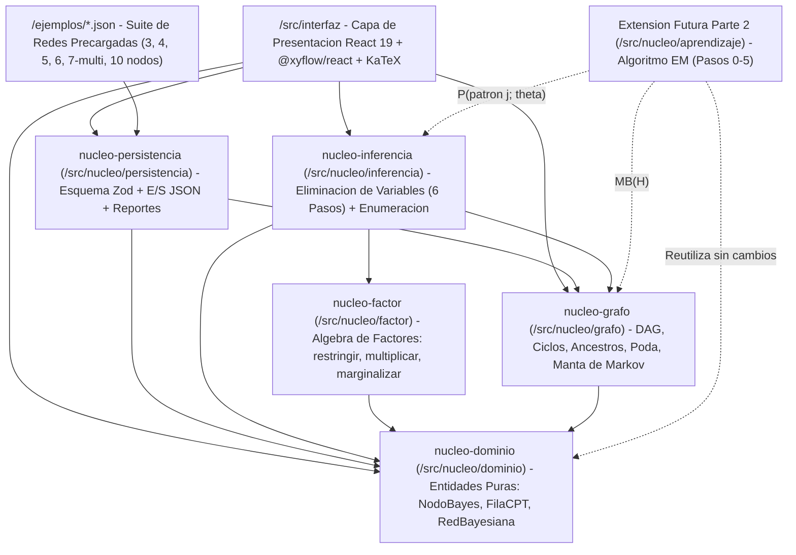
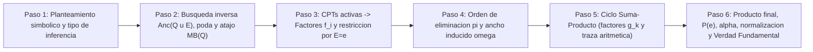

# PLANEACIÓN TÉCNICA, ESPECIFICACIÓN Y ARQUITECTURA — PROYECTO INTEGRADOR (PARTE 1)
**Materia:** Modelos Probabilistas · Ingeniería en Computación (FIE-UMSNH)  
**Sistema:** Aplicación GUI Multiplataforma para Modelado, Validación e Inferencia Exacta por Eliminación de Variables en Redes Bayesianas  
**Versión de Especificación:** `1.1.0` (Localización y Arquitectura 100% en Español)  
**Fecha:** 2 de noviembre de 2026  
**Estado:** `FASES A, B Y B.5 COMPLETADAS — NÚCLEO MATEMÁTICO Y PERSISTENCIA EN ESPAÑOL (49/49 PRUEBAS, 97% COBERTURA)`

---

> **Supuestos Explícitos y Alcance Inicial (`/using-agent-skills` · `/spec-driven-development`):**  
> Antes de escribir código de cada módulo, se declaran explícitamente los siguientes supuestos arquitectónicos y matemáticos extraídos de los requerimientos y de los apuntes oficiales del curso (*Inferencia exacta en redes bayesianas* y *Algoritmo EM en redes bayesianas*, Prof. Mauricio Reyes, 2026):
> 1. **Precisión numérica interna vs. visualización:** El motor matemático opera internamente con precisión completa de punto flotante IEEE 754 de 64 bits (`number` en TypeScript) sin redondear valores intermedios. El redondeo a 4 decimales (configurable a 4 o 6 en la GUI, con formato adaptativo para valores $< 0.001$ como `0.000991`) se aplica **únicamente** en la capa de presentación y reportes, garantizando coincidencia exacta con los resultados de clase.
> 2. **Convención de orden de estados:** Para variables binarias creadas desde la GUI, el orden canónico de estados es `["1", "0"]` (`1` = Sí arriba, `0` = No abajo) para que todas las tablas de factores $f_{X_i}$ y $g_k$ coincidan fila por fila con el material de clase. Para variables discretas multivaluadas ($k \ge 2$ estados, ej. `["PS5", "Xbox", "Switch 2"]`), se respeta el orden declarado en el arreglo `estados` del nodo.
> 3. **Preservación de factores constantes tras restringir evidencia:** Cuando todas las variables de un factor inicial pertenecen a la evidencia (ej. $P(R)$ restringido a $R=1 \implies f_R = 0.5000$), el factor escalar constante (`variables = []`) **no se descarta** durante el Paso 5; se conserva hasta la multiplicación final del Paso 6 para que la suma de valores no normalizados sea siempre igual a la probabilidad exacta de la evidencia $P(\mathbf{e})$ y $\alpha = 1 / P(\mathbf{e})$.
> 4. **Ejecución 100% en cliente (Zero-Backend SPA):** Toda la lógica de grafos, inferencia, persistencia de archivos `.json` y generación de reportes imprimibles corre localmente en el navegador sin requerir servidores externos, bases de datos ni conexión a internet tras cargar la aplicación.
> 5. **Extensibilidad hacia Parte 2 (Algoritmo EM):** En esta entrega solo se implementa la Parte 1 (Modelado + Eliminación de Variables + Enumeración verificadora), dejando listos los contratos de datos inmutables en `/src/nucleo/aprendizaje`, el cálculo de Manta de Markov y la probabilidad de evidencia $P(\text{patrón } j; \theta)$ que el módulo EM consumirá directamente en una futura Parte 2.

---

## 1. Investigación y Justificación del Stack Tecnológico (ADR)

### 1.1 Comparativa Técnica Objetiva de Alternativas

Se evaluaron cinco alternativas tecnológicas frente a los criterios obligatorios y puntos adicionales de la rúbrica (operación 100% GUI, lienzo DAG interactivo, multiplataforma real Windows/GNU-Linux/macOS, despliegue ejecutable en línea, impresión limpia de reportes con ecuaciones/tablas y aislamiento del motor matemático para TDD):

| Criterio Técnico / Rúbrica | **React 19 + Vite 8 + TypeScript + `@xyflow/react` (ELECCIÓN)** | Next.js (App Router) + TypeScript + `@xyflow/react` | Python + NiceGUI (FastAPI + Socket.IO) | Python + Streamlit | Python + PyQt6 / PySide6 |
| :--- | :--- | :--- | :--- | :--- | :--- |
| **Lienzo DAG interactivo nativo** | **Sobresaliente.** `@xyflow/react` v12 ofrece nodos HTML/React personalizados, aristas dirigidas con marcadores SVG, zoom/pan, selección y validación `isValidConnection` en tiempo real a 60 FPS. | **Sobresaliente** (mismo motor `@xyflow/react`, pero obliga a desactivar SSR con `'use client'`). | **Limitado.** No incluye editor nativo de grafos de nodos en su catálogo oficial; requiere wrappers de terceros y sincronización de coordenadas por WebSocket. | **Deficiente.** Sin editor DAG bidireccional nativo; los componentes en `iframe` sufren parpadeos y pérdida de estado en cada *rerun*. | **Medio-Alto.** `QGraphicsScene` permite grafos nativos, pero dibujar nodos ricos, tablas dinámicas y fórmulas matemáticas exige ~4x más código imperativo. |
| **Multiplataforma local (Win / Linux / macOS)** | **100% Idéntica.** Ejecuta sobre Node.js + cualquier navegador moderno sin diferencias entre X11, Wayland, Windows 11 o macOS ARM/Intel. | **100% Idéntica** en local, con mayor consumo de memoria en servidor de desarrollo. | **Alta** en navegador local, pero requiere entorno virtual Python y servidor activo. | **Alta** en navegador local con entorno Python activo. | **Media.** Fricciones frecuentes de binarios Qt6 en Linux (Wayland/xcb) y firmas en macOS Apple Silicon. |
| **Versión ejecutable en línea (Punto extra de rúbrica)** | **Óptima y gratuita.** `pnpm build` genera archivos estáticos puros (`dist/`) desplegables en Vercel, GitHub Pages o Cloudflare Pages sin servidor y sin suspensión por inactividad. | **Buena** en Vercel, pero el modo estático (`output: 'export'`) desaprovecha las funciones de servidor de Next.js añadiendo complejidad innecesaria. | **Compleja/Costosa.** Requiere servidor Python persistente en RAM y *sticky sessions* para WebSockets (no funciona en hosting estático). | **Limitada.** El modelo *top-to-bottom script rerun* añade latencia y Streamlit Community Cloud suspende instancias inactivas. | **Nula.** Aplicación exclusivamente de escritorio; imposible ejecutarla mediante un enlace web. |
| **Reportes imprimibles (PDF / HTML / LaTeX)** | **Nativa.** `@media print` de CSS + KaTeX (`renderToString`) produce documentos vectoriales listos para guardar en PDF desde el navegador o exportar en Markdown/HTML. | **Nativa** (igual en cliente, con cuidado extra de hidratación). | **Media.** Depende de impresión del navegador sobre DOM Quasar/Vue. | **Baja.** El layout de Streamlit corta tablas anchas al imprimir a PDF. | **Compleja.** `QPdfWriter` / `QTextDocument` tiene soporte CSS muy restringido y no renderiza LaTeX sin dependencias externas. |
| **TDD y separación Motor vs. GUI** | **Total.** `/src/nucleo` en TypeScript estricto sin dependencias de React ni DOM; Vitest 5 ejecuta toda la suite en `< 500 ms` compartiendo `vite.config.ts`. | **Alta**, pero requiere configurar Vitest por separado del bundler de Next.js. | **Alta** con `pytest`, acoplada al ecosistema Python. | **Media-Alta** si se separa el motor de llamadas `st.*`. | **Alta** para el motor con `pytest`; compleja para tests de interfaz (`pytest-qt`). |

---

### 1.2 Architecture Decision Records (ADRs)

#### ADR-001: Lenguaje Principal, Tipado Estricto y Gestor de Paquetes (`TypeScript` + `pnpm`)
* **Estado:** Aceptado · **Fecha:** 2026-11-02
* **Contexto:** El motor de Eliminación de Variables manipula tablas multidimensionales (CPTs y Factores $\phi$), asignaciones parciales de variables discretas de cardinalidad arbitraria y trazas paso a paso. Un error de tipos entre identificadores de nodos, nombres de estados o probabilidades numéricas produciría fallos silenciosos en tiempo de ejecución.
* **Decisión:** Adoptar **TypeScript (`^7.0.2`)** con `strict: true`, `noUncheckedIndexedAccess: true` y `exactOptionalPropertyTypes: true`, gestionando dependencias exclusivamente con **`pnpm` (`>=10.0.0`, verificado localmente `12.16.1`)** sobre **Node.js (`>=22.12.0`, verificado localmente `v26.13.0`)**.
* **Alternativas consideradas:**
  * *JavaScript sin tipos:* Rechazado por ausencia de contratos estáticos entre `/src/nucleo` y `/src/interfaz`.
  * *`npm` o `yarn`:* Rechazados frente a `pnpm` porque `pnpm` utiliza un almacén direccionable por contenido con enlaces duros, garantiza instalaciones deterministas mediante `pnpm-lock.yaml`, bloquea dependencias fantasma (*phantom dependencies*) y es significativamente más rápido en Windows, Linux y macOS.
* **Consecuencias:** Los contratos de datos en `/src/nucleo` sirven simultáneamente como código ejecutable en español académico y documentación formal verificada por el compilador.
* **Fuentes oficiales:**
  * TypeScript `tsconfig` Reference (`strict` / `noUncheckedIndexedAccess`): https://www.typescriptlang.org/tsconfig/#strict
  * pnpm Motivation & Strict `node_modules` Layout: https://pnpm.io/motivation

#### ADR-002: Arquitectura SPA Estática con `React 19`, `Vite 8` y `Tailwind CSS 4`
* **Estado:** Aceptado · **Fecha:** 2026-11-02
* **Contexto:** Se requiere una aplicación 100% gráfica que funcione sin fricción en Windows, GNU/Linux y macOS, permita generar reportes imprimibles limpios y ofrezca despliegue directo en un sitio web público sin costos ni mantenimiento de servidores.
* **Decisión:** Construir una Single-Page Application (SPA) estática usando **React (`^19.3.1`)**, **Vite (`^8.3.5`)** con `@vitejs/plugin-react` (`^6.2.1`), **Tailwind CSS (`^4.3.4`)** integrado vía el plugin oficial `@tailwindcss/vite` (`^4.3.4`), y gestión ligera de estado global en la interfaz con **Zustand (`^5.0.16`)**.
* **Alternativas consideradas:**
  * *Next.js:* Rechazado porque la aplicación no tiene rutas SSR, base de datos remota ni secretos de backend; Vite elimina la sobrecarga de hidratación SSR con `@xyflow/react` y comparte pipeline directo con Vitest.
  * *Python (Streamlit / NiceGUI / PyQt6):* Rechazados por las limitaciones documentadas en la tabla 1.1: Streamlit re-ejecuta el script completo en cada evento dificultando grafos bidireccionales fluidos; NiceGUI exige un servidor FastAPI/Socket.IO vivo incompatible con hosting estático gratuito; PyQt6 impide entregar una versión ejecutable en línea.
* **Consecuencias:** Arranque instantáneo en desarrollo (`pnpm dev`), empaquetado estático puro (`pnpm build` $\rightarrow$ `dist/`), estilos de impresión dedicados (`print:` variants de Tailwind CSS 4) y cero dependencia de red en ejecución.
* **Fuentes oficiales:**
  * Vite Getting Started & Templates (`react-ts`): https://vite.dev/guide/
  * React 19 Reference Documentation: https://react.dev/reference/react
  * Tailwind CSS v4 Official Vite Plugin (`@tailwindcss/vite`): https://tailwindcss.com/docs/installation/using-vite
  * Streamlit Execution Model (Full Script Reruns): https://docs.streamlit.io/develop/concepts/architecture/app-model
  * NiceGUI Deployment & WebSocket Architecture: https://nicegui.io/documentation/section_configuration_deployment

#### ADR-003: Lienzo Interactivo del DAG y Auto-Layout Jerárquico (`@xyflow/react` + `@dagrejs/dagre`)
* **Estado:** Aceptado · **Fecha:** 2026-11-02
* **Contexto:** El usuario debe crear, seleccionar, arrastrar y conectar de 3 a 10 nodos con flechas dirigidas claras, bloquear ciclos dirigidos en el instante en que intenta trazar una arista inválida, visualizar estados de nodos (Consulta $Q$, Evidencia $E=e$, Oculto activo $Y$, Podado) con bordes/colores/iconografía diferenciada y aplicar auto-layout jerárquico tipo DAG en un clic.
* **Decisión:** Utilizar **`@xyflow/react` (`^12.12.1`)** (paquete moderno oficial de React Flow v12) con componentes de nodo personalizados fuertemente tipados (`Node<DatosNodoFlujoBayes, 'nodoBayes'>`) y **`@dagrejs/dagre` (`^3.1.3`)** (distribución ESM oficial con tipos TypeScript incluidos) para el cálculo determinista de coordenadas jerárquicas de Arriba hacia Abajo (`TB`) y de Izquierda a Derecha (`LR`), convirtiendo las coordenadas centrales de Dagre a coordenadas `top-left` de React Flow.
* **Alternativas consideradas:**
  * *Cytoscape.js / D3-force puro:* Rechazados porque renderizan sobre `<canvas>` o SVG imperativo, dificultando incrustar etiquetas accesibles HTML/ARIA (rol del nodo, resumen de evidencia $E=1$, indicador de CPT inválida) y sincronizar el estado declarativo con React 19.
  * *ELKjs (`elkjs`):* Excelente para grafos masivos de miles de nodos con subgrafos anidados, pero pesa $>1.4\text{ MB}$ en el bundle; para redes de $3 \le N \le 10$ nodos, `@dagrejs/dagre` calcula el layout jerárquico óptimo en $< 1\text{ ms}$ con una fracción mínima de peso.
* **Consecuencias:** Interacción fluida con soporte nativo de teclado, controles de zoom/`fitView`, minimapa opcional y bloqueo visual inmediato de aristas que formen ciclos mediante `puedeAgregarArista`.
* **Fuentes oficiales:**
  * React Flow v12 (`@xyflow/react`) TypeScript Guide: https://reactflow.dev/learn/advanced-use/typescript
  * React Flow Official Layouting Guide with `@dagrejs/dagre`: https://reactflow.dev/learn/layouting/layouting

#### ADR-004: Validación en Fronteras, Tipografía Matemática y Motor de Pruebas (`Zod 4` + `KaTeX` + `Vitest 5`)
* **Estado:** Aceptado · **Fecha:** 2026-11-02
* **Contexto:** Los archivos `.json` importados desde disco son entradas externas no confiables que deben validarse sintáctica y semánticamente antes de llegar al motor matemático. Asimismo, los 6 pasos del método de clase requieren mostrar ecuaciones simbólicas exactas ($P(Q \mid \mathbf{e}) = \alpha \sum_Y \prod_i P(X_i \mid Pa(X_i))$) y probar el motor al 100% con TDD.
* **Decisión:**
  1. **`zod` (`^4.6.7`)** usando `.safeParse()` en la frontera de persistencia (`EsquemaRedJson`) para validar la estructura del esquema JSON en español y devolver uniones discriminadas `Resultado<RedBayesiana>` legibles sin excepciones no controladas.
  2. **`katex` (`^0.19.1`)** usando `katex.renderToString(..., { throwOnError: false, output: 'htmlAndMathml' })` para renderizar ecuaciones matemáticas síncronas, accesibles (MathML incluido para lectores de pantalla) e idénticas en pantalla y en impresión PDF.
  3. **`vitest` (`^5.1.0`)** + **`@vitest/coverage-v8` (`^5.1.0`)** para pruebas unitarias ultrarrápidas del motor matemático en `/pruebas/nucleo`, complementado con `@testing-library/react` (`^16.3.3`) y `jsdom` (`^30.1.3`) para pruebas de integración de componentes en `/pruebas/interfaz`.
* **Alternativas consideradas:**
  * *MathJax 3:* Más pesado y orientado a composición asíncrona del DOM; KaTeX es síncrono, determinista, incluye sus propias definiciones TypeScript (`types/katex.d.ts`) y funciona sin parpadeos al invocar `window.print()`.
  * *Jest:* Requiere transformadores adicionales (`ts-jest` / Babel) para ESM moderno; Vitest usa el mismo transformador nativo de Vite 8.
* **Consecuencias:** Validación robusta en fronteras (`/api-and-interface-design`), fórmulas con calidad de libro de texto y ciclo TDD en milisegundos.
* **Fuentes oficiales:**
  * Zod `safeParse` & TypeScript Inference: https://zod.dev/basics
  * KaTeX API (`katex.renderToString`): https://katex.org/docs/api.html
  * Vitest Configuration & V8 Coverage: https://vitest.dev/guide/coverage.html

#### ADR-005: Extensibilidad Arquitectónica para Aprendizaje EM con Variables Ocultas (Parte 2)
* **Estado:** Aceptado · **Fecha:** 2026-11-02
* **Contexto:** En el curso se estudia el Algoritmo EM (Pasos 0 al 5: separación de familias observadas vs. familias con variable oculta $H$, conteo directo MLE, Paso E por Manta de Markov con responsabilidades $r_j$, conteos esperados $\mathbb{E}[N]$, Paso M y verificación monótona de log-verosimilitud $\ell(\theta) = \sum_j n_j \ln P(\text{patrón } j; \theta)$). Si existe una Parte 2, el sistema debe admitir aprendizaje EM sin reescribir las entidades del dominio ni el lienzo gráfico.
* **Decisión:**
  1. Diseñar `RedBayesiana` como estructura de datos **inmutable** con operaciones puras de actualización de parámetros (`actualizarCptNodo(red, idNodo, nuevaCpt): RedBayesiana`), lo que permite representar limpiamente la secuencia de iteraciones $\theta^{(0)} \rightarrow \theta^{(1)} \rightarrow \theta^{(2)} \dots$ del algoritmo EM.
  2. Incluir la propiedad opcional `esLatente?: boolean` en la definición de `NodoBayes` (y en el esquema JSON) para que en el futuro el lienzo pueda dibujar nodos ocultos con borde punteado exactamente como en los apuntes de EM, sin romper archivos `.json` de la Parte 1.
  3. Exponer desde `/src/nucleo/grafo` la función pura `calcularMantaMarkov(red, idNodo)` (requerida hoy por la GUI y por el Paso 2 de Eliminación de Variables, y reutilizable directamente en el Paso 0 y Paso 2 de EM) y desde `/src/nucleo/inferencia` el cálculo exacto de $P(\mathbf{e})$ (`probabilidadEvidencia`, reutilizable directamente para evaluar $\ell(\theta) = \sum_j n_j \ln P(\text{patrón } j; \theta)$ en el Paso 5 de EM).
* **Consecuencias:** Cumple estrictamente YAGNI hoy (cero código muerto de EM en Parte 1) mientras garantiza compatibilidad estructural del 100% mañana.

---

### 1.3 Justificación Lista para `README.md` y Memoria Técnica (Multiplataforma y Ejecución en Línea)

> **Compatibilidad Multiplataforma y Despliegue Web:**  
> El sistema está construido como una Aplicación Web Estática Moderna (SPA) bajo estándares W3C/ECMAScript mediante TypeScript, React 19 y Vite 8. Al no depender de enlaces binarios específicos del sistema operativo (como DLLs de Win32, librerías X11/Wayland en GNU/Linux o frameworks Cocoa en macOS), el entorno de desarrollo y producción se ejecuta de forma bit-a-bit idéntica en **Windows (10/11), GNU/Linux (cualquier distribución) y macOS (Intel y Apple Silicon)** requiriendo únicamente Node.js y `pnpm`. Adicionalmente, el proceso de compilación (`pnpm build`) empaqueta toda la aplicación —incluyendo el motor matemático exacto de Eliminación de Variables y la galería de redes de ejemplo— en activos estáticos puros (`HTML/CSS/JS`) libres de servidor, permitiendo su publicación inmediata y permanente en plataformas gratuitas de distribución global (Vercel / GitHub Pages) para su evaluación directa desde cualquier navegador web sin instalación previa.

---

### 1.4 Requisitos del Sistema, Dependencias Exactas y Comandos Oficiales

#### Requisitos del Sistema Local
* **Node.js:** `>= 22.12.0` LTS (verificado en entorno actual: `v26.13.0`)
* **Gestor de paquetes:** `pnpm >= 10.0.0` (verificado en entorno actual: `12.16.1`)
* **Sistema Operativo:** Windows 10/11, GNU/Linux o macOS 13+
* **Navegador moderno:** Chromium / Chrome / Edge `>= 120`, Firefox `>= 121` o Safari `>= 17.2`

#### Lista Exacta de Dependencias (Versiones Verificadas en Registro `npm`)

| Paquete | Versión Verificada | Tipo | Rol Específico en la Arquitectura |
| :--- | :--- | :--- | :--- |
| `react` / `react-dom` | `^19.3.1` | `dependencies` | Renderizado declarativo de la interfaz gráfica y vistas de reporte. |
| `@xyflow/react` | `^12.12.1` | `dependencies` | Lienzo interactivo del DAG, nodos personalizados, aristas dirigidas y controles. |
| `@dagrejs/dagre` | `^3.1.3` | `dependencies` | Algoritmo de auto-layout jerárquico para DAGs (incluye sus propios tipos `.d.ts`). |
| `zod` | `^4.6.7` | `dependencies` | Validación declarativa con `.safeParse()` del esquema `.json` en fronteras de E/S. |
| `katex` | `^0.19.1` | `dependencies` | Renderizado tipográfico síncrono de ecuaciones LaTeX y MathML accesible (incluye `.d.ts`). |
| `zustand` | `^5.0.16` | `dependencies` | Estado reactivo ligero en `/src/interfaz` (red activa, consulta actual, traza e historial). |
| `lucide-react` | `^1.66.0` | `dependencies` | Iconografía vectorial consistente para controles, estados de validación y roles de nodos (WCAG AA). |
| `typescript` | `^7.0.2` | `devDependencies` | Compilador y verificador estático de tipos en modo estricto. |
| `vite` / `@vitejs/plugin-react` | `^8.3.5` / `^6.2.1` | `devDependencies` | Servidor de desarrollo HMR y empaquetador estático optimizado. |
| `tailwindcss` / `@tailwindcss/vite` | `^4.3.4` | `devDependencies` | Sistema de tokens visuales CSS y hojas de estilo de impresión (`@media print`). |
| `vitest` / `@vitest/coverage-v8` | `^5.1.0` | `devDependencies` | Ejecutor de pruebas unitarias TDD y reporte de cobertura V8 sobre `/src/nucleo`. |
| `@testing-library/react` / `@testing-library/jest-dom` / `jsdom` | `^16.3.3` / `^7.0.1` / `^30.1.3` | `devDependencies` | Pruebas de integración de interfaz (editor de CPTs, alertas de validación y visor de pasos). |
| `@types/react` / `@types/react-dom` | `^19.3.0` | `devDependencies` | Definiciones de tipos oficiales para React 19. |

*(Nota de verificación `/source-based-development`: Se comprobó contra el registro oficial que `@dagrejs/dagre@3.1.3` exporta `"types": "./dist/types/index.d.ts"` y `katex@0.19.1` exporta `"types": "types/katex.d.ts"`, por lo que **no** deben instalarse los paquetes legados `@types/dagre` ni `@types/katex`.)*

#### Comandos Ejecutables del Proyecto (`/spec-driven-development`)
```bash
pnpm install                          # Instala dependencias exactas desde pnpm-lock.yaml
pnpm dev                              # Inicia la GUI localmente en http://localhost:5173
pnpm typecheck                        # Ejecuta verificación estricta de tipos (tsc --noEmit)
pnpm test                             # Ejecuta Vitest en modo interactivo watch (ciclo TDD)
pnpm test:run                         # Ejecuta toda la suite de pruebas una sola vez (CI / verificación)
pnpm test:coverage                    # Ejecuta pruebas con reporte de cobertura V8 (meta: >= 95% en src/nucleo)
pnpm build                            # Verifica tipos y genera el sitio estático de producción en dist/
pnpm preview                          # Sirve localmente la compilación de producción dist/
```

---

## 2. Arquitectura Modular del Sistema

### 2.1 Mapa de Capacidades y Dirección de Dependencias (`/spec-driven-development`)

La arquitectura impone una **regla de dependencia unidireccional estricta**: la capa gráfica (`/src/interfaz`) consume al núcleo matemático (`/src/nucleo`), pero **`/src/nucleo` tiene prohibido importar cualquier símbolo de React, Zustand, `@xyflow/react` o APIs del DOM (`window`, `document`)**.



| ID de Módulo Estable | Responsabilidad Única | Depende de |
| :--- | :--- | :--- |
| `nucleo-dominio` | Tipos base (`NodoBayes`, `FilaCPT`, `RedBayesiana`), construcción de CPTs, validación de límites ($3 \le N \le 10$) y suma de filas ($1.0 \pm 10^{-6}$). | — |
| `nucleo-grafo` | Topología del DAG, detección incremental y global de ciclos, búsqueda de ancestros/descendientes, poda inversa, Manta de Markov y clasificación del tipo de inferencia. | `nucleo-dominio` |
| `nucleo-factor` | Estructura `Factor` ($\phi$), las 3 operaciones elementales (`restringirFactor`, `multiplicarFactores`, `marginalizarFactor`) y operador suma-producto `eliminarVariableConTraza` con formateo exacto de expresiones aritméticas y conteo de multiplicaciones. | `nucleo-dominio` |
| `nucleo-inferencia` | Orquestador exacto de los 6 Pasos de Eliminación de Variables (`ejecutarEliminacionVariables`), heurísticas de ordenamiento (`minimo-relleno`, `minimo-grado`, `practico-clase`, `manual`) y verificador secundario por Enumeración de la Conjunta Completa (`enumeracionConjuntaCompleta`). | `nucleo-dominio`, `nucleo-grafo`, `nucleo-factor` |
| `nucleo-persistencia` | Esquema `Zod` (`EsquemaRedJson`), serialización/deserialización JSON sin pérdida (`parsearRedJson`, `serializarRedJson`) y generador puro de reportes estructurados (`formatearReporteMarkdown`). | `nucleo-dominio`, `nucleo-grafo`, `nucleo-inferencia` |
| `interfaz-espacio-trabajo` | Lienzo interactivo `@xyflow/react`, editor dinámico de nodos/CPTs, visor de Manta de Markov, panel de consultas paso a paso y vista de impresión CSS/PDF. | `nucleo-*`, `ejemplos` |

**Orden de construcción:** `nucleo-dominio` $\rightarrow$ `nucleo-grafo` & `nucleo-factor` $\rightarrow$ `nucleo-inferencia` $\rightarrow$ `nucleo-persistencia` $\rightarrow$ `interfaz-espacio-trabajo`.

---

### 2.2 Árbol de Directorios del Proyecto (100% en Español)

```text
Proyecto-Integrador/
├── PLANEACION.md                         # Este documento maestro (Especificación + ADRs + Plan TDD)
├── DOCUMENTACION_EQUIPO.md               # Documento técnico limpio para Memoria Técnica y Manual de Usuario
├── README.md                             # Instrucciones multiplataforma, enlace web y guía rápida
├── package.json                          # Scripts y dependencias exactas gestionadas con pnpm
├── pnpm-lock.yaml                        # Lockfile determinista
├── tsconfig.json                         # Configuración estricta de TypeScript
├── vite.config.ts                        # Configuración unificada de Vite 8 + Tailwind 4 + Vitest 5
├── index.html                            # Punto de entrada SPA (-> /src/interfaz/main.tsx)
│
├── ejemplos/                             # Galería oficial de redes .json verificadas con la clase
│   ├── 01-ciberseguridad-3-nodos.json    # Red 1 (3 nodos): Cadena P -> C -> A
│   ├── 02-mundial-futbol-4-nodos.json    # Red 2 (4 nodos): Colisionador L -> F -> G <- R
│   ├── 03-videojuegos-5-nodos.json       # Red 3 (5 nodos): Causas múltiples D, R, T -> V -> K
│   ├── 04-ransomware-6-nodos.json        # Red 4 (6 nodos): P, V -> I -> C, T y C -> L (con poda)
│   ├── 05-mundial-octavos-10-nodos.json  # Red 5 (10 nodos): Red compleja Octavos de Final
│   └── bonus-consolas-multivaluada-7-nodos.json # Red Bonus (7 nodos): Variable tri-valuada Pl
│
├── src/
│   ├── nucleo/                           # MOTOR MATEMÁTICO PURO (0% dependencias de UI/DOM)
│   │   ├── index.ts                      # API pública controlada del núcleo matemático en español
│   │   ├── dominio/
│   │   │   ├── tipos.ts                  # Interfaces NodoBayes, FilaCPT, RedBayesiana, ProblemaValidacion
│   │   │   ├── cpt.ts                    # Combinaciones de padres, autocompletado binario y consulta P(X|Pa)
│   │   │   └── validadores.ts            # Validación 3..10 nodos, rangos [0,1] y suma 1.0 ± 1e-6
│   │   ├── grafo/
│   │   │   ├── dag.ts                    # Detección de ciclos (DFS tricolor + ruta), orden topológico, puedeAgregarArista()
│   │   │   ├── poda.ts                   # Búsqueda inversa de ancestros de Q ∪ E y podarNodosIrrelevantes()
│   │   │   ├── mantaMarkov.ts            # Cálculo exacto MB(X) = Pa(X) ∪ Ch(X) ∪ Copadres(X) y detección de atajo
│   │   │   └── tipoInferencia.ts         # Clasificador automático: Predictiva, Diagnóstica, Intercausal o Mixta
│   │   ├── factor/
│   │   │   ├── tipos.ts                  # Interfaces Factor, FilaFactor y ResultadoOperacionEliminacion
│   │   │   └── operaciones.ts            # cptAFactor, restringirFactor, multiplicarFactores, marginalizarFactor, eliminarVariableConTraza
│   │   ├── inferencia/
│   │   │   ├── tipos.ts                  # EntradaConsulta, EstrategiaEliminacion, TrazaEliminacionVariables (Pasos 1..6)
│   │   │   ├── heuristicas.ts            # Grafo de interacción, minimo-grado, minimo-relleno, practico-clase y ancho ω
│   │   │   ├── eliminacionVariables.ts   # Ejecutor exacto de los 6 pasos con generación de ecuaciones LaTeX y tablas g_k
│   │   │   └── enumeracionCompleta.ts    # Verificador de Verdad Fundamental por enumeración conjunta exhaustiva
│   │   ├── persistencia/
│   │   │   ├── esquema.ts                # EsquemaRedJson (Zod v4) + traducción de errores amigables en español
│   │   │   ├── serializador.ts           # parsearRedJson(), serializarRedJson() sin pérdida de metadatos ni diseño
│   │   │   └── formateadorReporte.ts     # Exportador puro de la red y traza completa de consulta a Markdown estructurado
│   │   └── aprendizaje/
│   │       └── tipos.ts                  # Contratos reservados (PatronConjuntoDatos, TrazaEM) para futura Parte 2 (EM)
│   │
│   ├── interfaz/                         # CAPA DE INTERFAZ GRÁFICA (React 19 + Tailwind CSS 4)
│   │   ├── Aplicacion.tsx                # Diseño principal de 3 paneles + modo vista de impresión
│   │   ├── main.tsx                      # Montaje React e importación de hojas CSS (Tailwind, React Flow, KaTeX)
│   │   ├── estilos/
│   │   │   └── index.css                 # Tokens semánticos de diseño académico y reglas @media print
│   │   ├── almacen/
│   │   │   └── usarAlmacenRed.ts         # Almacén Zustand que conecta eventos de UI con las funciones puras de src/nucleo
│   │   ├── componentes/
│   │   │   ├── barra-herramientas/
│   │   │   │   ├── BarraSuperior.tsx     # Nueva red, Galería de ejemplos, Importar/Guardar JSON, Auto-layout, Imprimir/Exportar
│   │   │   │   └── BannerValidacion.tsx  # Indicador global de estado del modelo y lista clicable de errores específicos
│   │   │   ├── lienzo/
│   │   │   │   ├── LienzoGrafoBayes.tsx  # Lienzo @xyflow/react con bloqueo de ciclos en tiempo real y leyenda accesible
│   │   │   │   ├── TarjetaNodoBayes.tsx  # Nodo personalizado (ID, nombre, estados, insignia de rol Q / E=e / Oculto / Podado)
│   │   │   │   └── disenoAutomatico.ts   # Adaptador @dagrejs/dagre (TB / LR)
│   │   │   ├── inspector/
│   │   │   │   ├── PanelInspectorNodo.tsx# Edición de ID, nombre, estados (binario/multivaluado) y padres
│   │   │   │   ├── TablaEditorCpt.tsx    # Tabla CPT dinámica con autocompletado binario 1-p y validación visual por fila
│   │   │   │   └── TarjetaMantaMarkov.tsx# Desglose visual de Padres, Hijos y Copadres + resaltado en el lienzo
│   │   │   ├── consulta/
│   │   │   │   ├── PanelConstructorConsulta.tsx # Selector de Q (1 o más variables), evidencia E=e y orden de eliminación π
│   │   │   │   ├── VisorTrazaPasos.tsx   # Acordeón/pestañas de los 6 pasos con fórmulas KaTeX y tablas f_i / g_k explícitas
│   │   │   │   └── VistaTablaFactor.tsx  # Renderizador tabular académico (estilo libro/clase) para factores y distribuciones
│   │   │   ├── reporte/
│   │   │   │   └── VistaReporteImprimible.tsx # Documento limpio listo para PDF (window.print) y descarga Markdown/HTML
│   │   │   └── comun/
│   │   │       └── FormulaMatematica.tsx # Envoltorio seguro y accesible sobre katex.renderToString
│
├── pruebas/                              # SUITE DE PRUEBAS AUTOMATIZADAS (Vitest 5)
│   ├── nucleo/
│   │   ├── cpt-y-validadores.test.ts     # Pruebas de rangos, suma 1.0 ± 1e-6, autocompletado y límites 3..10 nodos
│   │   ├── dag-y-poda.test.ts            # Pruebas de ciclos, ancestros, poda y Manta de Markov
│   │   ├── operaciones-factores.test.ts  # Pruebas unitarias de restringir, multiplicar y marginalizar (binario y multivaluado)
│   │   ├── heuristicas.test.ts           # Pruebas de minimo-grado, minimo-relleno y comparación de ancho inducido ω
│   │   ├── suite-referencia-clase.test.ts# Validación exacta al 100% de las 5 redes oficiales + red bonus multivaluada
│   │   ├── esquema-persistencia.test.ts  # Pruebas de importación/exportación JSON sin pérdida y rechazo de JSON corrupto
│   │   └── galeria-ejemplos.test.ts      # Validación integral extremo a extremo de los 6 archivos en /ejemplos/*.json
│   └── interfaz/
│       ├── TablaEditorCpt.test.tsx       # Prueba de edición interactiva y autocompletado P(X=0)=1-P(X=1)
│       └── FlujoTrazaConsulta.test.tsx   # Prueba de flujo completo de consulta y renderizado de los 6 pasos
│
└── documentacion/                        # DOCUMENTACIÓN Y ENTREGABLES COMPLEMENTARIOS DEL EQUIPO
    ├── decisiones/                       # Copia indexada de ADRs si se requiere consulta individual
    ├── guia-ejemplos-json.md             # Manual rápido para creación de redes JSON
    └── plantillas/                       # Plantillas base para Manual de Usuario y Memoria Técnica
```

---

### 2.3 Límites Operativos del Proyecto (`Boundaries` — `/spec-driven-development`)

* **Siempre hacer (`Always do`):**
  * Ejecutar `pnpm typecheck` y `pnpm test:run` antes de dar por terminada cualquier tarea o fase.
  * Validar toda entrada externa (archivos `.json` e inputs numéricos de usuario) en la frontera mediante `Zod` (`EsquemaRedJson`) y los validadores de `nucleo-dominio` y `nucleo-grafo`.
  * Acompañar todo código de color en la GUI con etiqueta textual, borde diferenciado e ícono (`WCAG 2.1 AA`, nunca depender solo del color).
* **Preguntar primero (`Ask first`):**
  * Agregar cualquier dependencia externa no listada en la Sección 1.4.
  * Modificar el esquema JSON (`versionEsquema: "1.0"`) de manera incompatible hacia atrás.
  * Ampliar el alcance hacia características de la Parte 2 (ejecución del algoritmo EM).
* **Nunca hacer (`Never do`):**
  * Importar librerías de caja negra para resolver inferencia bayesiana.
  * Redondear probabilidades dentro de los cálculos internos de `/src/nucleo`.
  * Acoplar `/src/nucleo` a React, Zustand o al DOM.
  * Reclamar que una tarea está completa sin evidencia fresca de ejecución de comandos (`/verification-before-completion`).

---

## 3. Diseño de Estructuras de Datos y Especificación del Formato JSON

### 3.1 Contratos e Interfaces Internas en TypeScript (`/api-and-interface-design`)

Siguiendo el principio *Contract First*, todas las operaciones del núcleo reciben y devuelven tipos explícitos e inmutables en español académico, usando una **estrategia única y consistente de errores estructurados** (`ProblemaValidacion` / `Resultado<T, readonly ProblemaValidacion[]>`):

```typescript
// src/nucleo/dominio/tipos.ts

/** Identificador corto y único de un nodo en la red (ej. "P", "Le", "Pl"). */
export type IdNodo = string;

/** Valor discreto de estado de una variable aleatoria (ej. "1", "0", "PS5", "Xbox", "Switch 2"). */
export type ValorEstado = string;

/** Asignación parcial o completa de variables a sus estados discretos: { P: "1", V: "0" }. */
export type AsignacionVariables = Readonly<Record<IdNodo, ValorEstado>>;

/** Fila condicional explícita de una Tabla de Probabilidad Condicional: P(X = estado | Pa(X) = cuando). */
export interface FilaCPT {
  /** Asignación de valores para cada padre en nodo.padres ({} para nodos raíz sin padres). */
  readonly cuando: AsignacionVariables;
  /** Mapa exhaustivo estado -> probabilidad en [0, 1] cuya suma es 1.0 ± 1e-6. */
  readonly probabilidades: Readonly<Record<ValorEstado, number>>;
}

/** Definición completa e inmutable de un nodo en una Red Bayesiana. */
export interface NodoBayes {
  readonly id: IdNodo;
  readonly nombre: string;
  readonly descripcion?: string;
  /** Lista ordenada de >= 2 estados únicos. Binario canónico: ["1", "0"]. */
  readonly estados: readonly ValorEstado[];
  /** Etiquetas legibles opcionales por estado, ej. { "1": "Sí", "0": "No" }. */
  readonly etiquetasEstados?: Readonly<Record<ValorEstado, string>>;
  /** Identificadores ordenados de los nodos padres directos en el DAG. */
  readonly padres: readonly IdNodo[];
  /** Coordenadas visuales en el lienzo preservadas sin pérdida al importar/exportar JSON. */
  readonly posicion: { readonly x: number; readonly y: number };
  /** Tabla de Probabilidad Condicional P(X | Pa(X)) con ∏|estados(P)| filas. */
  readonly cpt: readonly FilaCPT[];
  /** Bandera opcional reservada para la Parte 2 (variables latentes/ocultas en aprendizaje EM). */
  readonly esLatente?: boolean;
}

/** Consulta predefinida opcional incluida en los archivos .json de ejemplo. */
export interface ConsultaPredefinida {
  readonly id: string;
  readonly etiqueta: string;
  readonly descripcion?: string;
  readonly variablesConsulta: readonly IdNodo[];
  readonly evidencia: AsignacionVariables;
  readonly ordenSugerido?: readonly IdNodo[];
  /** Distribución posterior esperada para verificación automatizada y pruebas TDD. */
  readonly posteriorEsperada?: Readonly<Record<string, number>>;
}

/** Entidad raíz inmutable que representa una Red Bayesiana completa. */
export interface RedBayesiana {
  readonly versionEsquema: '1.0';
  readonly metadatos: {
    readonly id: string;
    readonly titulo: string;
    readonly descripcion?: string;
    readonly autor?: string;
    readonly dominio?: string;
    readonly actualizadoEn?: string;
  };
  readonly nodos: readonly NodoBayes[];
  readonly consultasPredefinidas?: readonly ConsultaPredefinida[];
}

export type CodigoErrorValidacion =
  | 'RED_MINIMO_NODOS'
  | 'RED_MAXIMO_NODOS'
  | 'ID_NODO_DUPLICADO'
  | 'ID_NODO_INVALIDO'
  | 'ESTADOS_NODO_INVALIDOS'
  | 'ID_PADRE_DESCONOCIDO'
  | 'ID_PADRE_DUPLICADO'
  | 'CICLO_DAG_DETECTADO'
  | 'CPT_CONTEO_FILAS_INVALIDO'
  | 'CPT_COMBINACION_FALTANTE'
  | 'CPT_PROBABILIDAD_FUERA_DE_RANGO'
  | 'CPT_SUMA_FILA_INVALIDA'
  | 'ERROR_VALIDACION_ESQUEMA';

/** Estructura uniforme de diagnóstico para errores sintácticos, topológicos o matemáticos. */
export interface ProblemaValidacion {
  readonly codigo: CodigoErrorValidacion;
  readonly severidad: 'error' | 'advertencia';
  readonly idNodo?: IdNodo;
  readonly mensaje: string;
  readonly detalles?: Readonly<Record<string, unknown>>;
}

/** Unión discriminada de resultado para operaciones de frontera y persistencia. */
export type Resultado<T, E = readonly ProblemaValidacion[]> =
  | { readonly exito: true; readonly valor: T }
  | { readonly exito: false; readonly errores: E };
```

#### Representación Interna de un Factor ($\phi$, $f_{X_i}$ o $g_k$)

```typescript
// src/nucleo/factor/tipos.ts
import type { AsignacionVariables, IdNodo, ValorEstado } from '../dominio/tipos';

export interface FilaFactor {
  /** Asignación ordenada de las variables en el alcance del factor ({} cuando es constante escalar). */
  readonly asignacion: AsignacionVariables;
  /** Valor numérico exacto en doble precisión IEEE 754 (nunca redondeado internamente). */
  readonly valor: number;
  /**
   * Traza aritmética explícita idéntica a las tablas de clase,
   * ej. "0.3000 · 0.4000 + 0.7000 · 0.0200" o "0.3007 + 0.0863".
   */
  readonly textoCalculo?: string;
}

export interface Factor {
  /** Identificador simbólico para visualización académica: "f_P", "f_C", "g_1", "g_2", etc. */
  readonly id: string;
  /** Etiqueta legible de procedencia, ej. "P(A | C) restringido a A=1". */
  readonly etiquetaOrigen: string;
  /** Variables ordenadas en el alcance del factor ([] cuando se redujo a constante escalar). */
  readonly variables: readonly IdNodo[];
  /** Dominios discretos ordenados para cada variable en `variables`. */
  readonly dominios: Readonly<Record<IdNodo, readonly ValorEstado[]>>;
  /** Tabla explícita de filas en orden lexicográfico respecto a `variables` y `dominios`. */
  readonly filas: readonly FilaFactor[];
}
```

> **¿Por qué representar CPTs y Factores con filas explícitas + mapa de clave canónica interna?**  
> Con un máximo de $N = 10$ nodos (p. ej., $2^{10} = 1024$ combinaciones en el peor caso global, y factores típicos de 2 a 32 filas), un factor indexado internamente por una clave canónica de asignación (`construirClaveAsignacion`) y respaldado por su arreglo `filas` ejecuta toda una consulta de 10 nodos en **menos de $0.5\text{ ms}$**, funciona sin ningún caso especial para variables de 2, 3, 4 o $k$ estados, y expone directamente las filas exactas y expresiones aritméticas (`textoCalculo`) que la GUI y el reporte imprimible necesitan mostrar.

---

### 3.2 Especificación Oficial del Esquema `.json` de Persistencia (`versionEsquema: "1.0"`)

El formato `.json` fue diseñado íntegramente en español bajo el criterio de **cero ambigüedad posicional**: en lugar de obligar a escribir arreglos planos de números cuyo orden es propenso a errores humanos, cada fila condicional de la CPT declara explícitamente `"cuando": { "<idPadre>": "<estado>" }` y `"probabilidades": { "<estadoNodo>": <numero> }`.

#### Diccionario de Campos del Esquema `.json`

| Ruta del Campo | Tipo | Obligatorio | Reglas de Validación |
| :--- | :--- | :---: | :--- |
| `versionEsquema` | `"1.0"` | Sí | Cadena literal `"1.0"` para control de compatibilidad futura. |
| `metadatos.id` | `string` | Sí | Identificador kebab-case del archivo/red (ej. `"ciberseguridad-3-nodos"`). |
| `metadatos.titulo` | `string` | Sí | Título descriptivo de la red (1 a 200 caracteres). |
| `metadatos.descripcion` | `string` | No | Contexto del problema modelado. |
| `metadatos.autor` | `string` | No | Autor o equipo creador del modelo. |
| `metadatos.dominio` | `string` | No | Área de aplicación del modelo (ej. `"Ciberseguridad"`, `"Deportes"`). |
| `metadatos.actualizadoEn` | `string` | No | Marca de tiempo ISO 8601 opcional de última edición. |
| `nodos` | `NodoBayes[]` | Sí | Arreglo con **mínimo 3 y máximo 10 nodos** (`3 <= nodos.length <= 10`). |
| `nodos[i].id` | `string` | Sí | Identificador único corto (ej. `"P"`, `"Le"`, `"Pl"`), alfanumérico sin espacios (`^[A-Za-z][A-Za-z0-9_]*$`). |
| `nodos[i].nombre` | `string` | Sí | Nombre legible del nodo (ej. `"Phishing"`, `"Plataforma"`). |
| `nodos[i].descripcion` | `string` | No | Significado completo de la variable aleatoria. |
| `nodos[i].estados` | `string[]` | Sí | Mínimo 2 estados únicos no vacíos (ej. `["1", "0"]` o `["PS5", "Xbox", "Switch 2"]`). |
| `nodos[i].etiquetasEstados` | `Record<string,string>` | No | Etiquetas descriptivas opcionales para cada estado. |
| `nodos[i].padres` | `string[]` | Sí | Lista de `id` de padres directos (`[]` si es nodo raíz). No puede contener auto-referencias ni formar ciclos dirigidos. |
| `nodos[i].posicion` | `{ x: number, y: number }` | Sí | Coordenadas finitas en píxeles en el lienzo interactivo. |
| `nodos[i].cpt` | `FilaCPT[]` | Sí | Debe tener exactamente $\prod_{P \in \text{padres}} |\text{estados}(P)|$ filas ($1$ fila con `"cuando": {}` si `padres` es `[]`). |
| `nodos[i].cpt[r].cuando` | `Record<string,string>` | Sí | Un par `"idPadre": "estadoValido"` por cada padre del nodo, cubriendo sin duplicados todo el producto cartesiano. |
| `nodos[i].cpt[r].probabilidades` | `Record<string,number>` | Sí | Un valor en $[0, 1]$ por cada estado en `nodos[i].estados`. La suma de la fila debe cumplir $\left|\sum p - 1.0\right| \le 10^{-6}$. |
| `nodos[i].esLatente` | `boolean` | No | Bandera opcional reservada para variables latentes en una futura Parte 2 (EM). |
| `consultasPredefinidas` | `ConsultaPredefinida[]` | No | Lista opcional de consultas de verificación rápidas (`id`, `etiqueta`, `descripcion`, `variablesConsulta`, `evidencia`, `ordenSugerido`, `posteriorEsperada`). |

#### Ejemplo Completo y 100% Válido: Red 1 de 3 Nodos (`ejemplos/01-ciberseguridad-3-nodos.json`)

> **Nota importante sobre JSON estándar (RFC 8259):** Los archivos `.json` reales **no admiten comentarios `//` ni comas finales**. El bloque siguiente es JSON 100% válido listo para guardarse y abrirse directamente en el sistema:

```json
{
  "versionEsquema": "1.0",
  "metadatos": {
    "id": "ciberseguridad-3-nodos",
    "titulo": "Ejercicio 1: Ciberseguridad — Cadena de Phishing (3 nodos)",
    "descripcion": "Una empresa modela cómo un correo de phishing puede terminar en un acceso no autorizado: el phishing permite robar credenciales y las credenciales robadas permiten entrar al sistema (cadena P -> C -> A).",
    "autor": "Modelos Probabilistas · FIE-UMSNH",
    "dominio": "Ciberseguridad"
  },
  "nodos": [
    {
      "id": "P",
      "nombre": "Phishing",
      "descripcion": "Un empleado recibe un correo de phishing",
      "estados": ["1", "0"],
      "etiquetasEstados": { "1": "Sí", "0": "No" },
      "padres": [],
      "posicion": { "x": 100, "y": 180 },
      "cpt": [
        {
          "cuando": {},
          "probabilidades": { "1": 0.3, "0": 0.7 }
        }
      ]
    },
    {
      "id": "C",
      "nombre": "Credenciales",
      "descripcion": "Le roban las credenciales al empleado",
      "estados": ["1", "0"],
      "etiquetasEstados": { "1": "Sí", "0": "No" },
      "padres": ["P"],
      "posicion": { "x": 380, "y": 180 },
      "cpt": [
        {
          "cuando": { "P": "1" },
          "probabilidades": { "1": 0.4, "0": 0.6 }
        },
        {
          "cuando": { "P": "0" },
          "probabilidades": { "1": 0.02, "0": 0.98 }
        }
      ]
    },
    {
      "id": "A",
      "nombre": "Acceso",
      "descripcion": "Hay un acceso no autorizado al sistema",
      "estados": ["1", "0"],
      "etiquetasEstados": { "1": "Sí", "0": "No" },
      "padres": ["C"],
      "posicion": { "x": 660, "y": 180 },
      "cpt": [
        {
          "cuando": { "C": "1" },
          "probabilidades": { "1": 0.7, "0": 0.3 }
        },
        {
          "cuando": { "C": "0" },
          "probabilidades": { "1": 0.01, "0": 0.99 }
        }
      ]
    }
  ],
  "consultasPredefinidas": [
    {
      "id": "ex1-a-predictiva-marginal",
      "etiqueta": "P(A) — Probabilidad marginal de acceso no autorizado",
      "descripcion": "¿Cuál es la probabilidad de que ocurra un acceso no autorizado sin evidencia previa?",
      "variablesConsulta": ["A"],
      "evidencia": {},
      "ordenSugerido": ["P", "C"],
      "posteriorEsperada": { "1": 0.1025, "0": 0.8975 }
    },
    {
      "id": "ex1-b-diagnostica",
      "etiqueta": "P(P | A=1) — Diagnóstico de phishing dado acceso no autorizado",
      "descripcion": "Se detectó un acceso no autorizado. ¿Qué tan probable es que todo haya empezado con un correo de phishing?",
      "variablesConsulta": ["P"],
      "evidencia": { "A": "1" },
      "ordenSugerido": ["C"],
      "posteriorEsperada": { "1": 0.8374, "0": 0.1626 }
    }
  ]
}
```

#### Ejemplo de Nodo Multivaluado ($k = 3$ estados) bajo el Mismo Esquema

Para una variable discreta con 3 o más estados (como `Pl` en `ejemplos/bonus-consolas-multivaluada-7-nodos.json`), la representación mantiene exactamente la misma estructura sin reglas especiales:

```json
{
  "id": "Pl",
  "nombre": "Plataforma",
  "descripcion": "Plataforma principal del lanzamiento",
  "estados": ["PS5", "Xbox", "Switch 2"],
  "padres": [],
  "posicion": { "x": 620, "y": 220 },
  "cpt": [
    {
      "cuando": {},
      "probabilidades": {
        "PS5": 0.5,
        "Xbox": 0.2,
        "Switch 2": 0.3
      }
    }
  ]
}
```

---

## 4. Diseño Detallado del Algoritmo de Eliminación de Variables (6 Pasos)

El motor en `/src/nucleo/factor` y `/src/nucleo/inferencia` implementa desde cero las operaciones algebraicas sobre factores y produce un objeto inmutable `TrazaEliminacionVariables` con toda la información simbólica, tabular y métrica de los **6 pasos exactos vistos en clase**.

### 4.1 Las 3 Operaciones Elementales sobre Factores ($\phi$)

1. **`restringirFactor(factor, variable, valorObservado)`**:
   * Filtra `factor.filas` conservando únicamente aquellas filas donde `fila.asignacion[variable] === valorObservado`.
   * Proyecta cada fila eliminando la clave `variable` de `asignacion` y quita `variable` de `factor.variables`.
   * **Caso escalar constante:** Si `factor.variables` tenía una sola variable (`[variable]`), el resultado es un factor constante válido con `variables = []` y una única fila `{ asignacion: {}, valor: p }` (ej. $f_R = 0.5000$ cuando $R=1$).
2. **`multiplicarFactores(factorA, factorB)`**:
   * Calcula la unión ordenada de alcances $Z = \text{vars}(factorA) \cup \text{vars}(factorB)$ preservando el orden canónico de variables de la red.
   * Genera todas las asignaciones del producto cartesiano $\prod_{V \in Z} \text{estados}(V)$.
   * Para cada asignación $\mathbf{z}$, extrae la sub-asignación compatible $\mathbf{x} = \mathbf{z}|_{\text{vars}(A)}$ y $\mathbf{y} = \mathbf{z}|_{\text{vars}(B)}$, y asigna $\phi_Z(\mathbf{z}) = \phi_A(\mathbf{x}) \cdot \phi_B(\mathbf{y})$ registrando 1 multiplicación escalar por fila.
3. **`marginalizarFactor(factor, variable)`**:
   * Define el nuevo alcance $S = \text{vars}(factor) \setminus \{variable\}$.
   * Para cada asignación $\mathbf{s}$ sobre $S$, suma los valores de todas las filas compatibles variando $z \in \text{estados}(variable)$:
     $$g(\mathbf{s}) = \sum_{z \in \text{estados}(variable)} \phi(\mathbf{s}, variable = z)$$

> **Operador compuesto de traza académica `eliminarVariableConTraza(factoresConZ, variable, indicePaso)`:**  
> En los ejercicios de clase donde **3 o más factores** contienen simultáneamente a la variable eliminada $Z_k$ (ej. Ejercicio 4.1 Paso 5.1 al eliminar $E$ de $f_E, f_M, f_{Pg}$, o Ejercicio 10.1 Paso 5.2 al eliminar $Cl$ de $f_{Cl}, f_G, f_{Ta}$), multiplicar de dos en dos ocultaría la expresión unificada de la tabla. Por ello, nuestro motor ejecuta internamente el producto punto a punto de los $m$ factores $\mathcal{F}_k = \{f_1, \dots, f_m\}$ evaluados en $(\mathbf{s}, Z_k = z)$ y la marginalización sobre $Z_k$, verificando por prueba unitaria su equivalencia exacta con `marginalizarFactor(factoresConZ.reduce(multiplicarFactores), variable)`, pero construyendo además la cadena exacta de cada fila:
> $$\text{textoCalculo}(\mathbf{s}) = \text{"}v_{1,z_1} \cdot v_{2,z_1} \cdots v_{m,z_1} + v_{1,z_2} \cdot v_{2,z_2} \cdots v_{m,z_2} + \dots\text{"}$$
> y contabilizando con precisión exacta el número de multiplicaciones escalares:
> $$\text{mults}(\text{Paso } 5.k) = \begin{cases} |\text{filas}(g_k)| \times |\text{estados}(Z_k)| \times (m - 1) & \text{si } m \ge 2 \\ 0 & \text{si } m = 1 \text{ (solo suma, ej. } g_3(S) = \sum_{Pg} g_2(Pg, S)\text{)} \end{cases}$$

---

### 4.2 Flujo Exacto de los 6 Pasos en `/src/nucleo/inferencia/eliminacionVariables.ts`



#### Paso 1. Plantear la consulta y clasificar el tipo de inferencia
* **Entrada:** Red validada $\mathcal{B}$, conjunto no vacío de variables de consulta $Q \subset V$, mapa de evidencia $E = \{E_1: e_1, \dots, E_r: e_r\}$ con $Q \cap \text{keys}(E) = \emptyset$.
* **Partición de variables:**
  * Consulta: $Q$ (`variablesConsulta`)
  * Evidencia: $E$ (`evidencia`)
  * Ocultas iniciales: $Y_{\text{todas}} = V \setminus (Q \cup \text{keys}(E))$ (`todasVariablesOcultas`)
* **Generación de ecuación LaTeX completa:**
  $$P(Q \mid E=e) = \alpha \sum_{Y_{\text{todas}}} \prod_{i=1}^{N} P(X_i \mid Pa(X_i))$$
  *(Si $E = \emptyset$, se omite $\mid E=e$ dejando $P(Q) = \alpha \sum_{Y_{\text{todas}}} \prod_i P(X_i \mid Pa(X_i))$ con nota $\alpha = 1$).*
* **Clasificación topológica automática del tipo de inferencia (`clasificarTipoInferencia`):**
  1. Si $E = \emptyset \implies$ **`Predictiva (marginal sin evidencia)`**.
  2. Si $|Q| = 1$ y $MB(Q_1) \subseteq \text{keys}(E) \implies$ bandera destacada **`usaAtajoMantaMarkov: true`** (*Atajo por Manta de Markov*).
  3. Sea $\text{Anc}(Q)$ el conjunto de ancestros estrictos de $Q$ (`obtenerAncestros`) y $\text{Desc}(Q)$ el conjunto de descendientes estrictos de $Q$ (`obtenerDescendientes`):
     * **`Intercausal (Explicación alternativa / Explaining-away)`:** Existe al menos un nodo observado $e_{\text{efecto}} \in \text{keys}(E) \cap \text{Desc}(Q)$ y otro nodo observado $e_{\text{causa}} \in \text{keys}(E) \setminus (\text{Anc}(Q) \cup \text{Desc}(Q))$ tal que $e_{\text{efecto}} \in \text{Desc}(e_{\text{causa}})$, sin evidencias adicionales fuera de este patrón (ej. $P(R \mid K=1, D=1)$ en Red 3).
     * **`Predictiva o Causal`:** Todo nodo en $\text{keys}(E)$ es ancestro de $Q$ ($\text{keys}(E) \subseteq \text{Anc}(Q)$).
     * **`Diagnóstica`:** Ningún nodo en $\text{keys}(E)$ es ancestro de $Q$, y toda evidencia proviene de descendientes $\text{Desc}(Q)$ o efectos laterales conectados únicamente a través de ancestros comunes no observados (ej. $P(P \mid A=1)$ o $P(Cb \mid Pg=0)$).
     * **`Mixta`:** Combina simultáneamente evidencia aguas arriba (ancestros/co-causas) y aguas abajo (descendientes/efectos en múltiples ramas), como en $P(G \mid Le=1, A=1, S=0)$.

#### Paso 2. Podar variables irrelevantes y detectar Manta de Markov
* **Algoritmo de búsqueda inversa en el DAG (`podarNodosIrrelevantes`):**
  1. Inicializar cola BFS y conjunto visitado `relevantes = new Set([...variablesConsulta, ...Object.keys(evidencia)])`.
  2. Mientras la cola no esté vacía, extraer nodo `u`, y para cada `p` en `u.padres`: si `p` no está en `relevantes`, insertar `p` en `relevantes` y encolarlo.
  3. `nodosActivos` $= [X \in \text{nodos} \mid X.\text{id} \in \text{relevantes}]$.
  4. `nodosPodados` $= [X \in \text{nodos} \mid X.\text{id} \notin \text{relevantes}]$.
  5. `variablesOcultasActivas` $Y = [X.\text{id} \in \text{nodosActivos} \mid X.\text{id} \notin Q \land X.\text{id} \notin E]$.
* **Salida para la GUI:** Lista explícita de `nodosPodados` con justificación matemática ($\sum_{x} P(x \mid Pa(X)) = 1$), coloreado atenuado con borde punteado en el lienzo, ecuación LaTeX reducida sobre `nodosActivos`, y —si $|Q|=1 \land MB(Q_1) \subseteq \text{keys}(E)$ (`estaMantaMarkovCompletamenteObservada`)— bloque explicativo del **Atajo por Manta de Markov**:
  $$P(Q_1 \mid MB(Q_1)) \propto P(Q_1 \mid Pa(Q_1)) \prod_{Y \in Ch(Q_1)} P(Y \mid Pa(Y))$$

#### Paso 3. Factores iniciales y restricción por evidencia
* Para cada nodo activo $X_i \in \text{nodosActivos}$:
  1. Convertir $P(X_i \mid Pa(X_i))$ en el factor inicial $f_{X_i}(Pa(X_i), X_i)$ mediante `cptAFactor`.
  2. Para cada variable $E_j \in \text{alcance}(f_{X_i}) \cap \text{keys}(E)$, aplicar `restringirFactor(f, E_j, E[E_j])`.
  3. Registrar tanto el factor restringido resultante como qué evidencias se aplicaron (`esConstanteEscalar: true` mostrando `"f_R = 0.5000"` cuando `variables.length === 0`).

#### Paso 4. Orden de eliminación ($\pi$) y cálculo de ancho inducido ($\omega$)
* Sobre el conjunto de variables ocultas activas $Y$ y la lista de factores activos iniciales $\mathcal{F}_0$ (`calcularOrdenEliminacion` y `simularOrdenEliminacion`):
  * Construir el **grafo de interacción** $G_I = (Y, E_I)$ donde dos variables ocultas $u, v \in Y$ tienen una arista no dirigida si y solo si coexisten en el alcance de algún factor $f \in \mathcal{F}$.
  * **Estrategias disponibles (`EstrategiaEliminacion`):**
    1. **`minimo-grado`:** En cada iteración elige $Z \in Y$ con menor número de vecinos actuales $|N_{G_I}(Z)|$ (desempate por menor peso de estados $\prod_{W \in N(Z) \cup \{Z\}} |\text{estados}(W)|$ y orden topológico). Conecta en clique a $N_{G_I}(Z)$ y elimina $Z$.
    2. **`minimo-relleno` (predeterminada recomendada):** En cada iteración elige $Z \in Y$ cuya eliminación añada el **menor número de aristas nuevas** entre pares no conectados de $N_{G_I}(Z)$ (desempate por `minimo-grado` y peso de estados).
    3. **`practico-clase`:** Orden práctico heurístico de los apuntes (prioriza raíces con un solo hijo y extremos simples de un solo vecino antes de nodos puente).
    4. **`manual`:** Permutación exacta de $Y$ elegida por el usuario en la GUI (`ordenManual`).
  * **Simulador comparativo de costo:** Calcula para cualquier orden $\pi$ el **tamaño máximo de factor intermedio** (`maxTamanoAlcanceFactorFormado` $\omega_{\text{pre}} = \max_k |U_k|$ y `maxTamanoAlcanceFactorCreado` $\omega_{g} = \max_k |S_k|$) y el costo exacto en multiplicaciones (`totalMultiplicaciones`), permitiendo comparar en vivo un buen orden contra un mal orden.

#### Paso 5. Ciclo de Eliminación (Suma-Producto)
* Inicializar lista de trabajo `factoresActuales = [...factoresInicialesRestringidos]`.
* Para $k = 1 \dots |\pi|$ con variable $Z_k = \pi[k - 1]$:
  1. Particionar `factoresActuales` en:
     * `factoresConZ` $= \{f \in \text{factoresActuales} \mid Z_k \in f.\text{variables}\}$
     * `factoresSinZ` $= \{f \in \text{factoresActuales} \mid Z_k \notin f.\text{variables}\}$
  2. Ejecutar `g_k = eliminarVariableConTraza(factoresConZ, Z_k, k)`, nombrando el nuevo factor $g_k(S_k)$ y registrando su ecuación LaTeX:
     $$g_k(S_k) = \sum_{Z_k} \prod_{f \in \text{factoresConZ}} f$$
  3. Actualizar `factoresActuales = [...factoresSinZ, g_k]`.
  4. Guardar en `traza.paso5.subPasos` el sub-paso `5.k`: variable eliminada $Z_k$, factores involucrados, tabla completa de $g_k$ con su columna `Cálculo` (`textoCalculo`), multiplicaciones ejecutadas en este sub-paso y lista simbólica de `"Factores que quedan"` (`etiquetasFactoresRestantes`).

#### Paso 6. Multiplicación final, Normalización y Doble Verificación (Verdad Fundamental)
1. **Multiplicación de factores restantes (`multiplicarFactoresFinalesConTraza`):** Todos los factores en `factoresActuales` dependen exclusivamente de subconjuntos de $Q$ (o son constantes escalares `variables = []`). Para cada asignación $\mathbf{q}$ del producto cartesiano de $Q$:
   * Evaluar cada factor restante $f_1, \dots, f_r$ en $\mathbf{q}$, calcular el producto no normalizado $\tilde{P}(\mathbf{q}) = \prod_{j=1}^{r} f_j(\mathbf{q}|_{\text{vars}(f_j)})$, guardar la cadena `"0.2500 · 0.5841"` y sumar $(r - 1)$ multiplicaciones por fila (si $r \ge 2$).
2. **Probabilidad de la evidencia y constante $\alpha$:**
   $$P(\mathbf{e}) = \sum_{\mathbf{q}} \tilde{P}(\mathbf{q}), \qquad \alpha = \frac{1}{P(\mathbf{e})}$$
   * *Manejo seguro de evidencia imposible:* Si $P(\mathbf{e}) = 0$, el motor no divide por cero; marca `esEvidenciaImposible: true` (`alfa: null`) y emite un diagnóstico claro indicando que la evidencia observada tiene probabilidad conjunta nula en el modelo.
3. **Normalización:** Para cada $\mathbf{q}$, $P(Q = \mathbf{q} \mid \mathbf{e}) = \alpha \cdot \tilde{P}(\mathbf{q})$.
4. **Doble Verificación Automática por Enumeración de la Conjunta Completa (`enumeracionConjuntaCompleta`):**
   * Recorre la red **completa sin podar** ($N \le 10$ nodos). Fija las variables observadas en $E = e$ y enumera exhaustivamente todas las combinaciones posibles de las variables libres $V \setminus \text{keys}(E)$ (total de términos: $T_{\text{enum}} = \prod_{X \notin E} |\text{estados}(X)|$).
   * Cada término evalúa el producto de las $N$ CPTs de la red, realizando exactamente:
     $$\text{mults}_{\text{enum}} = T_{\text{enum}} \times (N - 1)$$
     multiplicaciones escalares (coincidiendo exactamente con la métrica de *"Comprobación"* de todos los ejercicios del curso).
   * Acumula la probabilidad conjunta sobre cada $\mathbf{q} \in \text{dom}(Q)$, normaliza y verifica que:
     $$\max_{\mathbf{q}} \left| P_{\text{EV}}(Q = \mathbf{q} \mid \mathbf{e}) - P_{\text{Enum}}(Q = \mathbf{q} \mid \mathbf{e}) \right| < 10^{-9}$$
   * Reporta en `traza.paso6.verdadFundamental` el sello `verificado: true`, `terminosEnumerados`, `multiplicacionesEnumeracion`, `multiplicacionesEliminacionVariables`, `multiplicacionesAhorradas` y `porcentajeAhorro`.

---

## 5. Guía de Trabajo Paralelo para el Equipo (Manual de Usuario, Ejemplos y Memoria Técnica)

Gracias al diseño *Contract First* de las Secciones 1 a 4, el resto del equipo puede trabajar en paralelo en los archivos `.json` propios, el Manual de Usuario en PDF y la Memoria Técnica en PDF.

### 5.1 Instrucciones Paso a Paso para Redactar o Adaptar las 5 Redes `.json` sin Errores

Cualquier integrante puede abrir VS Code (o cualquier editor de texto) y crear las redes propias del equipo de **3, 4, 5, 6 y 10 nodos** copiando como plantilla el JSON de la Sección 3.2 y siguiendo estas **6 Reglas de Oro**:

1. **Cantidad de nodos permitida:** El arreglo `"nodos"` debe contener entre **3 y 10 objetos** (`3, 4, 5, 6 y 10` para los 5 ejemplos requeridos por la evaluación).
2. **Cero ciclos dirigidos (Regla de Niveles Topológicos):** Para garantizar que su grafo sea un DAG sin ciclos al diseñarlo en papel:
   * Organicen los nodos por niveles de arriba hacia abajo (Nivel 1: causas raíz sin padres `"padres": []`; Nivel 2: nodos cuyos padres están solo en el Nivel 1; Nivel 3: nodos cuyos padres están en Niveles 1 o 2, etc.).
   * **Regla infalible:** Si todo nodo solo tiene padres de niveles superiores (o listados antes que él en el archivo), **jamás existirá un ciclo dirigido**.
3. **Conteo exacto de filas en cada CPT ($\prod |Pa(X_i)|$):**
   * Si `"padres": []` (nodo raíz) $\implies$ `"cpt"` tiene **exactamente $1$ fila** con `"cuando": {}`.
   * Si todos los padres son binarios (`2` estados):
     * `1` padre $\implies 2^1 = \mathbf{2}$ **filas**.
     * `2` padres $\implies 2^2 = \mathbf{4}$ **filas**.
     * `3` padres $\implies 2^3 = \mathbf{8}$ **filas**.
   * Si algún padre es multivaluado, multipliquen la cantidad de estados de cada padre (ej. padre `VL` de `2` estados y padre `Pl` de `3` estados $\implies 2 \times 3 = \mathbf{6}$ **filas**).
4. **Suma exacta de probabilidades por fila ($1.0$):** En **cada** objeto `"probabilidades"` dentro de `"cpt"`, todos los números deben estar entre `0.0` y `1.0`, y la suma de los estados de esa fila debe dar **exactamente `1.0`** (ej. `{"1": 0.85, "0": 0.15}` o `{"PS5": 0.5, "Xbox": 0.2, "Switch 2": 0.3}`).
5. **Consistencia exacta de nombres (Case-Sensitive):** Si un nodo se declara con `"id": "Rk"` y `"estados": ["1", "0"]`, sus hijos deben referenciar exactamente `"Rk"` (no `"rk"` ni `"RK"`) y usar `"1"` o `"0"` como cadenas entre comillas (`"1"`, no el número `1`) dentro de `"cuando"`.
6. **Sintaxis JSON pura:** No incluyan comentarios `//` ni dejen una coma `,` después del último elemento de una lista u objeto (VS Code subraya en rojo cualquier coma sobrante automáticamente si el archivo termina en `.json`).

#### Catálogo de Referencia Precargado en `/ejemplos` (Suite de Verificación del Curso)

El sistema incluye de fábrica estas 5 redes oficiales de clase (+ 1 red bonus multivaluada) verificadas al 100%, además de permitir importar las 5 redes propias que diseñe el equipo:

| Archivo en `/ejemplos` | Nodos | Estructura Topológica (Padres $\rightarrow$ Hijos) | Consultas de Verificación y Verdad Fundamental Exacta |
| :--- | :---: | :--- | :--- |
| `01-ciberseguridad-3-nodos.json` | **3** | $P \rightarrow C \rightarrow A$ | • $P(A=1) = \mathbf{0.1025}$ (8 mults vs 16)<br/>• $P(P=1 \mid A=1) = \mathbf{0.8374}$ (6 mults vs 8) |
| `02-mundial-futbol-4-nodos.json` | **4** | $L \rightarrow F \rightarrow G \leftarrow R$ | • $P(G=1 \mid R=1) = \mathbf{0.4380}$ (10 mults vs 24)<br/>• $P(L=1 \mid G=0) = \mathbf{0.2476}$ (10 mults vs 24) |
| `03-videojuegos-5-nodos.json` | **5** | $D, R, T \rightarrow V \rightarrow K$ | • $P(R=1 \mid K=1) = \mathbf{0.5616}$ (30 mults vs 64)<br/>• $P(R=1 \mid K=1, D=1) = \mathbf{0.5204}$ (16 mults vs 32) |
| `04-ransomware-6-nodos.json` | **6** | $P, V \rightarrow I \rightarrow C, T$; $C \rightarrow L$ | • $P(I=1 \mid T=1, L=1) = \mathbf{0.9898}$ (20 mults vs 80)<br/>• $P(V=1 \mid L=1) = \mathbf{0.6092}$ podando $T$ (22 mults vs 160) |
| `05-mundial-octavos-10-nodos.json` | **10** | `Le, Rk` $\to$ `Of` $\to$ `Go`; `Rk, Pf` $\to$ `Df`; `Of, Df, Cl` $\to$ `G`; `Df, Cl` $\to$ `Ta`; `G, Go` $\to$ `Cm` | • $P(Le=1 \mid Cm=1, Go=0, Ta=0) = \mathbf{0.2149}$ (78 mults vs 1152)<br/>• $P(G=1 \mid Le=1, Cl=1) = \mathbf{0.3870}$ podando `Go, Ta, Cm` (36 mults vs 2304) |
| `bonus-consolas-multivaluada-7-nodos.json` | **7** | `X, R, Mk` $\to$ `VL`; `VL, Pl` $\to$ `VT` $\to$ `D` (`Pl` con 3 estados: `PS5, Xbox, Switch 2`) | • $P(Pl=\text{PS5} \mid D=1) = \mathbf{0.5289}$ (49 mults vs 576)<br/>• $P(R=1 \mid D=1, Mk=1, Pl=\text{Xbox}) = \mathbf{0.5152}$ |

---

### 5.2 Plantilla de Documentación por cada Red para el Manual de Usuario (PDF)

Para cada uno de los **5 ejemplos del equipo (3, 4, 5, 6 y 10 nodos)**, el equipo debe documentar la siguiente ficha estandarizada en el **Manual de Usuario** (la vista de impresión/reporte y `formatearReporteMarkdown` generan automáticamente las secciones 2 a 6 listas para exportar o capturar):

1. **Título y Contexto del Dominio:** Descripción en 3-5 líneas del fenómeno probabilista modelado.
2. **Tabla Diccionario de Variables:** Columnas `ID` | `Nombre` | `Significado` | `Estados posibles` | `Padres directos`.
3. **Diagrama del Grafo Dirigido Acíclico (DAG):** Captura del lienzo interactivo mostrando nodos y aristas dirigidas (y colores de rol durante la consulta).
4. **Tablas de Probabilidad Condicional (CPTs):** Tablas $P(X_i \mid Pa(X_i))$ verificadas.
5. **Planteamiento de Consultas (mínimo 2 por red):**
   * Pregunta en lenguaje natural.
   * Expresión matemática $P(Q \mid E=e)$, clasificación del tipo de inferencia (Predictiva, Diagnóstica, Intercausal o Mixta) y Manta de Markov de un nodo clave.
6. **Traza Paso a Paso e Interpretación:**
   * Paso 1 y 2: Ecuación factorizada y nodos podados (si aplica).
   * Paso 3 y 4: Factores iniciales restringidos y orden de eliminación $\pi$.
   * Paso 5: Tablas explícitas de cada factor intermedio $g_k$ con sus operaciones aritméticas.
   * Paso 6: Tabla no normalizada, probabilidad de la evidencia $P(\mathbf{e})$, constante $\alpha$, distribución final $P(Q \mid \mathbf{e})$, ahorro de multiplicaciones frente a enumeración e **interpretación cualitativa del resultado**.

---

### 5.3 Índice de la Memoria Técnica (PDF) Redactable Desde Hoy

El equipo de documentación puede iniciar **hoy mismo** la redacción formal en LaTeX / Word de los capítulos 1 al 5 de la **Memoria Técnica**, tomando directamente las secciones de `DOCUMENTACION_EQUIPO.md` / `PLANEACION.md`:

* **Capítulo 1. Introducción y Marco Teórico** *(Redactable hoy)*: Definición de Red Bayesiana, factorización de la conjunta, independencia condicional, Manta de Markov, tipos de inferencia y complejidad de Eliminación de Variables frente a Enumeración Exhaustiva.
* **Capítulo 2. Análisis de Alternativas y Justificación Tecnológica** *(Tomar directo de Sección 1.1, 1.2, 1.3 y 1.4)*: Tabla comparativa de stacks, ADRs 001–005, compatibilidad multiplataforma (Windows/Linux/macOS) y estrategia de despliegue web estático.
* **Capítulo 3. Arquitectura de Software y Diseño Modular** *(Tomar directo de Sección 2.1 y 2.2)*: Diagrama de arquitectura desacoplada (`/src/nucleo` vs `/src/interfaz`), responsabilidades por módulo y diseño extensible para aprendizaje EM (Parte 2).
* **Capítulo 4. Estructuras de Datos y Especificación de Persistencia JSON** *(Tomar directo de Sección 3.1 y 3.2)*: Modelo interno de `NodoBayes`, `FilaCPT`, `Factor` ($\phi$) y especificación formal del esquema `.json` en español con validaciones de integridad matemática.
* **Capítulo 5. Diseño Algorítmico del Motor de Inferencia** *(Tomar directo de Sección 4.1 y 4.2)*: Álgebra de factores (`restringirFactor`, `multiplicarFactores`, `marginalizarFactor`), poda inversa en DAG, heurísticas `minimo-grado` y `minimo-relleno`, traza de los 6 pasos y verificador de Verdad Fundamental.
* **Capítulo 6. Pruebas, Validación Experimental y Resultados** *(Motor `/src/nucleo` ya verificado con 49/49 pruebas al 97% de cobertura; se completa con capturas al cerrar Fase D)*: Tabla comparativa de resultados obtenidos por el software frente a los cálculos teóricos de las 5 redes y reporte de cobertura de pruebas unitarias (`pnpm test:coverage`).

---

## 6. Plan de Implementación Incremental por Fases (Task Breakdown con TDD)

La construcción sigue rigurosamente `/test-driven-development` (ciclo **RED $\rightarrow$ GREEN $\rightarrow$ REFACTOR**), `/incremental-implementation` (rebanadas pequeñas de $\le 5$ archivos por tarea dejando siempre el repositorio compilable), `/frontend-ui-engineering` + `/impeccable` (modo **Operate/Read**: precisión académica, jerarquía tipográfica clara, accesibilidad `WCAG 2.1 AA`, cero estética genérica de IA) y `/verification-before-completion` (puntos de control con evidencia real de terminal/navegador antes de avanzar de fase).

---

### Fase A: Inicialización y Motor Matemático Puro con TDD (`/src/nucleo/dominio`, `grafo`, `factor`, `inferencia`)

#### Tarea A.1: Inicialización del Proyecto Vite 8 + TypeScript + Tailwind 4 + Vitest 5
* **Descripción:** Inicializar el proyecto con `pnpm`, configurar `tsconfig.json` estricto, `vite.config.ts` con `@tailwindcss/vite` y `vitest` (cobertura V8 sobre `src/nucleo`), y verificar el pipeline vacío.
* **Criterios de aceptación:**
  * [x] `package.json` contiene exclusivamente las dependencias verificadas de la Sección 1.4.
  * [x] `pnpm typecheck`, `pnpm test:run` y `pnpm build` terminan con código de salida `0`.
* **Verificación:** Ejecutar `pnpm typecheck && pnpm test:run && pnpm build`.
* **Archivos tocados:** `package.json`, `tsconfig.json`, `vite.config.ts`, `index.html`, `src/interfaz/main.tsx` *(Tamaño: M)*.

#### Tarea A.2: Dominio, CPTs Multivaluadas y Validadores Matemáticos (TDD)
* **Descripción:** Implementar tipos base, generación del producto cartesiano de padres (`generarCombinacionesPadres`), consulta de probabilidades $P(X \mid Pa)$ (`obtenerProbabilidadCondicional`), autocompletado binario $1 - p$ (`autocompletarFilaBinaria`) y validadores de red ($3 \le N \le 10$, rangos $[0,1]$, suma por fila $1.0 \pm 10^{-6}$).
* **Criterios de aceptación:**
  * [x] Rechaza redes con `< 3` o `> 10` nodos con códigos `RED_MINIMO_NODOS` / `RED_MAXIMO_NODOS`.
  * [x] Valida CPTs binarias y multivaluadas ($k \ge 3$) detectando filas faltantes o sumas fuera de $1.0 \pm 10^{-6}$.
* **Verificación:** `pnpm test:run pruebas/nucleo/cpt-y-validadores.test.ts`.
* **Dependencias:** Tarea A.1.
* **Archivos tocados:** `src/nucleo/dominio/tipos.ts`, `src/nucleo/dominio/cpt.ts`, `src/nucleo/dominio/validadores.ts`, `pruebas/nucleo/cpt-y-validadores.test.ts` *(Tamaño: M)*.

#### Tarea A.3: Operaciones de Grafo DAG, Poda Inversa, Manta de Markov y Tipo de Inferencia (TDD)
* **Descripción:** Implementar detección de ciclos dirigidos (`detectarCicloDirigido`), `puedeAgregarArista(red, idOrigen, idDestino)`, `obtenerOrdenTopologico`, poda inversa de no-ancestros de $Q \cup E$ (`podarNodosIrrelevantes`), cálculo de $MB(X)$ (`calcularMantaMarkov`) y clasificación automática del tipo de inferencia (`clasificarTipoInferencia`).
* **Criterios de aceptación:**
  * [x] Detecta ciclos simples ($A \to A$, $A \to B \to A$) y complejos ($A \to B \to C \to D \to B$).
  * [x] Poda exactamente `T` en Red 4b ($P(V \mid L=1)$) y `Go, Ta, Cm` en Red 5b ($P(G \mid Le=1, Cl=1)$).
  * [x] Calcula con exactitud $MB(I) = \{P, V, C, T\}$ en Red 4 y $MB(G) = \{Cl, Of, Df, Go, Cm\}$ en Red 5.
* **Verificación:** `pnpm test:run pruebas/nucleo/dag-y-poda.test.ts`.
* **Dependencias:** Tarea A.2.
* **Archivos tocados:** `src/nucleo/grafo/dag.ts`, `src/nucleo/grafo/poda.ts`, `src/nucleo/grafo/mantaMarkov.ts`, `src/nucleo/grafo/tipoInferencia.ts`, `pruebas/nucleo/dag-y-poda.test.ts` *(Tamaño: M)*.

#### Tarea A.4: Álgebra de Factores y Traza Aritmética Explícita (TDD)
* **Descripción:** Implementar conversión `cptAFactor`, las 3 operaciones elementales (`restringirFactor`, `multiplicarFactores`, `marginalizarFactor`) soportando factores constantes escalares (`variables = []`) y `eliminarVariableConTraza` con conteo exacto de multiplicaciones.
* **Criterios de aceptación:**
  * [x] Restringir un factor univariado produce un factor escalar constante sin perder su valor numérico.
  * [x] Multiplicar y marginalizar variables binarias y tri-valuadas genera tablas y cadenas `textoCalculo` idénticas a los apuntes de clase.
* **Verificación:** `pnpm test:run pruebas/nucleo/operaciones-factores.test.ts`.
* **Dependencias:** Tarea A.2.
* **Archivos tocados:** `src/nucleo/factor/tipos.ts`, `src/nucleo/factor/operaciones.ts`, `pruebas/nucleo/operaciones-factores.test.ts` *(Tamaño: S)*.

#### Tarea A.5: Heurísticas de Ordenamiento, Motor de 6 Pasos y Verificador de Verdad Fundamental (TDD)
* **Descripción:** Implementar `minimo-grado`, `minimo-relleno`, `practico-clase` y `manual` con cálculo de ancho inducido $\omega$, el orquestador completo de los 6 pasos (`ejecutarEliminacionVariables`), el verificador `enumeracionConjuntaCompleta` y la suite TDD con las **6 redes de referencia del curso (3, 4, 5, 6, 7-multivaluada y 10 nodos)**.
* **Criterios de aceptación:**
  * [x] Todas las consultas de referencia coinciden a $\ge 4$ decimales con los resultados de clase y a $< 10^{-9}$ contra Enumeración Exhaustiva (`0.1025`, `0.8374`, `0.4380`, `0.2476`, `0.5616`, `0.5204`, `0.9898`, `0.6092`, `0.5289`, `0.5152`, `0.2149`, `0.3870`).
  * [x] El conteo de multiplicaciones de EV y de Enumeración coincide con los números exactos del material de clase (ej. `78 vs 1152` en Red 5a y `36 vs 2304` en Red 5b).
* **Verificación:** `pnpm test:run pruebas/nucleo/heuristicas.test.ts pruebas/nucleo/suite-referencia-clase.test.ts`.
* **Dependencias:** Tareas A.3 y A.4.
* **Archivos tocados:** `src/nucleo/inferencia/tipos.ts`, `src/nucleo/inferencia/heuristicas.ts`, `src/nucleo/inferencia/eliminacionVariables.ts`, `src/nucleo/inferencia/enumeracionCompleta.ts`, `pruebas/nucleo/heuristicas.test.ts`, `pruebas/nucleo/suite-referencia-clase.test.ts` *(Tamaño: M)*.

> **🚩 Checkpoint Fase A (COMPLETADO):** `pnpm typecheck` limpio + `100%` de pruebas del motor pasando + cobertura $\ge 95\%$ en `/src/nucleo`.

---

### Fase B y B.5: Persistencia JSON en Español, Esquema Zod, Galería `/ejemplos` y Localización Completa

#### Tarea B.1: Esquema Zod v4, Serializador sin Pérdida y Formateador Markdown (TDD)
* **Descripción:** Implementar `EsquemaRedJson` con `zod.safeParse()`, conversión de errores a diagnósticos legibles en español, serialización de ida y vuelta sin pérdida (`parsearRedJson`, `serializarRedJson`) y generación de reporte Markdown (`formatearReporteMarkdown`).
* **Criterios de aceptación:**
  * [x] Abrir una red, modificar un nodo/CPT y exportar conserva intactos todos los metadatos y coordenadas.
  * [x] Archivos JSON malformados, con ciclos o con CPTs que no suman `1.0` son rechazados en frontera con mensajes específicos indicando el nodo afectado.
* **Verificación:** `pnpm test:run pruebas/nucleo/esquema-persistencia.test.ts`.
* **Dependencias:** Fase A.
* **Archivos tocados:** `src/nucleo/persistencia/esquema.ts`, `src/nucleo/persistencia/serializador.ts`, `src/nucleo/persistencia/formateadorReporte.ts`, `src/nucleo/aprendizaje/tipos.ts`, `pruebas/nucleo/esquema-persistencia.test.ts` *(Tamaño: M)*.

#### Tarea B.2 y B.5: Creación, Localización 100% a Español y Validación de `/ejemplos/*.json`
* **Descripción:** Codificar los 6 archivos `.json` completos en `/ejemplos` bajo el esquema oficial en español (`versionEsquema`, `metadatos`, `nodos`, `cuando`, `probabilidades`, `consultasPredefinidas`), reestructurar todas las carpetas, archivos, interfaces y 49 pruebas unitarias a español académico y sincronizar `PLANEACION.md` + `DOCUMENTACION_EQUIPO.md`.
* **Criterios de aceptación:**
  * [x] Los 6 archivos `.json` en `/ejemplos` pasan validación Zod, validación DAG, validación CPT y verificación contra Verdad Fundamental.
  * [x] Cero carpetas o archivos antiguos en inglés; `49/49` pruebas pasando con `>= 95%` de cobertura en `/src/nucleo`.
* **Verificación:** `pnpm typecheck && pnpm test:coverage && pnpm build`.
* **Dependencias:** Tarea B.1.
* **Archivos tocados:** `ejemplos/*.json`, `src/nucleo/**`, `src/interfaz/**`, `pruebas/nucleo/*.test.ts`, `PLANEACION.md`, `DOCUMENTACION_EQUIPO.md` *(Tamaño: M)*.

> **🚩 Checkpoint Fase B / B.5 (COMPLETADO):** Base 100% en español verificada con `49/49` pruebas al `97%` de cobertura y lista para iniciar Fase C (GUI).

---

### Fase C: Lienzo Interactivo del DAG y Editor Dinámico de CPTs (`/frontend-ui-engineering` · `/impeccable`)

#### Tarea C.1: Sistema de Diseño Académico, Almacén Reactivo y Barra Superior de Persistencia
* **Descripción:** Configurar tokens visuales semánticos en `src/interfaz/estilos/index.css` (paleta editorial sobria de alto contraste WCAG AA, tipografía tabular `tabular-nums` para probabilidades, cero gradientes genéricos), crear `usarAlmacenRed` en Zustand y `BarraSuperior` (Nueva red, Selector de Galería `/ejemplos`, Importar `.json`, Guardar `.json`, Auto-layout `TB`/`LR` y `BannerValidacion`).
* **Criterios de aceptación:**
  * [ ] Cargar cualquiera de las redes de la galería actualiza el estado global instantáneamente.
  * [ ] Importar un `.json` inválido muestra una alerta clara y accionable sin romper el estado actual.
* **Verificación:** `pnpm typecheck && pnpm build` + verificación funcional en navegador.
* **Dependencias:** Fase B.5.
* **Archivos tocados:** `src/interfaz/estilos/index.css`, `src/interfaz/almacen/usarAlmacenRed.ts`, `src/interfaz/componentes/barra-herramientas/BarraSuperior.tsx`, `src/interfaz/componentes/barra-herramientas/BannerValidacion.tsx`, `src/interfaz/Aplicacion.tsx` *(Tamaño: M)*.

#### Tarea C.2: Lienzo `@xyflow/react`, Nodos Semánticos, Bloqueo de Ciclos en Tiempo Real y Auto-Layout Dagre
* **Descripción:** Implementar `LienzoGrafoBayes`, `TarjetaNodoBayes` y `disenoAutomatico.ts` con `@dagrejs/dagre`. Distinguir mediante color, borde, insignia textual e ícono los 4 estados de nodo: **Consulta ($Q$)**, **Evidencia ($E=e$)**, **Oculto Activo ($Y$)** y **Podado (atenuado + borde punteado)**. Conectar `isValidConnection` / `onConnect` a `puedeAgregarArista()` para bloquear ciclos dirigidos y límite de 10 nodos en tiempo real con notificación explicativa.
* **Criterios de aceptación:**
  * [ ] El usuario puede crear nodos (respetando $3 \le N \le 10$), arrastrarlos, conectarlos/desconectarlos con flechas dirigidas claras y aplicar auto-layout jerárquico.
  * [ ] Intentar conectar un hijo hacia un ancestro es bloqueado inmediatamente mostrando la ruta del ciclo evitado.
* **Verificación:** `pnpm typecheck && pnpm build` + inspección en navegador sin errores de consola.
* **Dependencias:** Tarea C.1.
* **Archivos tocados:** `src/interfaz/componentes/lienzo/LienzoGrafoBayes.tsx`, `src/interfaz/componentes/lienzo/TarjetaNodoBayes.tsx`, `src/interfaz/componentes/lienzo/disenoAutomatico.ts` *(Tamaño: M)*.

#### Tarea C.3: Inspector de Nodo, Tabla CPT Dinámica y Visor de Manta de Markov
* **Descripción:** Construir el panel lateral `PanelInspectorNodo` para editar ID, nombre, estados (preset binario `1/0` o editor libre de $k \ge 2$ estados multivaluados), relaciones de padres, `TablaEditorCpt` con autocompletado automático $P(X=0 \mid \cdot) = 1 - P(X=1 \mid \cdot)$ para variables binarias y validación visual instantánea de suma `1.0000` por fila, más `TarjetaMantaMarkov` con resaltado de Padres, Hijos y Copadres en el grafo.
* **Criterios de aceptación:**
  * [ ] Agregar o quitar un padre o un estado redimensiona dinámicamente la CPT (`redimensionarCptNodo`) conservando valores compatibles.
  * [ ] Al ingresar `P(X=1 | ·) = 0.3` en variable binaria, `P(X=0 | ·)` se autocompleta a `0.7` con precisión limpia (evitando artefactos como `0.7000000000000001`).
  * [ ] Consultar la Manta de Markov muestra su fórmula $MB(X)$ y resalta sus integrantes en el lienzo.
* **Verificación:** `pnpm test:run pruebas/interfaz/TablaEditorCpt.test.tsx` + `pnpm build`.
* **Dependencias:** Tarea C.2.
* **Archivos tocados:** `src/interfaz/componentes/inspector/PanelInspectorNodo.tsx`, `src/interfaz/componentes/inspector/TablaEditorCpt.tsx`, `src/interfaz/componentes/inspector/TarjetaMantaMarkov.tsx`, `pruebas/interfaz/TablaEditorCpt.test.tsx` *(Tamaño: M)*.

> **🚩 Checkpoint Fase C:** Edición visual 100% GUI de redes binarias y multivaluadas, bloqueo de ciclos en vivo, validación de CPTs e importación/exportación JSON funcionando de extremo a extremo.

---

### Fase D: Panel de Consultas, Visor Paso a Paso (6 Pasos) y Reporte Imprimible

#### Tarea D.1: Constructor de Consultas y Selector/Comparador de Orden de Eliminación ($\pi$)
* **Descripción:** Implementar `PanelConstructorConsulta` permitiendo asignar una o más variables a Consulta ($Q$), fijar valores de Evidencia ($E=e$), cargar consultas predefinidas de ejemplos a un clic, y elegir orden de eliminación (`minimo-relleno`, `minimo-grado`, `practico-clase` o reordenamiento `manual`) mostrando en vivo el ancho máximo de factor ($\omega$) y bloqueo preventivo si la red aún tiene errores de validación.
* **Criterios de aceptación:**
  * [ ] Bloquea la ejecución con mensaje específico si la red tiene $< 3$ nodos o alguna fila CPT inválida.
  * [ ] Cambiar entre orden óptimo y orden manual actualiza las tablas $g_k$, el ancho máximo $\omega$ y el conteo de multiplicaciones, comprobando que la distribución final $P(Q \mid e)$ permanece invariante.
* **Verificación:** `pnpm typecheck && pnpm build`.
* **Dependencias:** Fase C.
* **Archivos tocados:** `src/interfaz/componentes/consulta/PanelConstructorConsulta.tsx`, `src/interfaz/componentes/comun/FormulaMatematica.tsx` *(Tamaño: S)*.

#### Tarea D.2: Visor Académico de los 6 Pasos (`VisorTrazaPasos` y `VistaTablaFactor`)
* **Descripción:** Construir el desglose visual interactivo de los **6 Pasos Obligatorios**: ecuaciones simbólicas KaTeX (Paso 1 y Paso 2 con poda y atajo de Manta de Markov), cuadrícula de factores iniciales restringidos $f_{X_i}$ (Paso 3), grafo/métricas del orden $\pi$ (Paso 4), secuencia de sub-pasos `5.1, 5.2, ...` mostrando las tablas explícitas $g_k$ con su columna `Cálculo` aritmético y `"Factores que quedan"` (Paso 5), y tabla final con valores no normalizados, $P(\mathbf{e})$, $\alpha = 1/P(\mathbf{e})$, distribución $P(Q \mid \mathbf{e})$ y tarjeta de **Doble Verificación de Verdad Fundamental vs. Enumeración Completa** (Paso 6).
* **Criterios de aceptación:**
  * [ ] Los 6 pasos se renderizan con tipografía matemática KaTeX y tablas alineadas con números tabulares.
  * [ ] Prueba de integración confirma que ejecutar una consulta sobre las redes de ejemplo renderiza los factores $g_k$ y la distribución normalizada exacta.
* **Verificación:** `pnpm test:run pruebas/interfaz/FlujoTrazaConsulta.test.tsx`.
* **Dependencias:** Tarea D.1.
* **Archivos tocados:** `src/interfaz/componentes/consulta/VisorTrazaPasos.tsx`, `src/interfaz/componentes/consulta/VistaTablaFactor.tsx`, `pruebas/interfaz/FlujoTrazaConsulta.test.tsx` *(Tamaño: M)*.

#### Tarea D.3: Módulo de Reporte Imprimible (PDF / Vista de Impresión / Exportación Markdown y HTML)
* **Descripción:** Implementar `VistaReporteImprimible` y estilos `@media print` dedicados para que, con un clic en *"Imprimir / Guardar PDF"* o *"Exportar Reporte (.md / .html)"*, se genere un documento académico completo (encabezado de la red, diagrama vectorial del DAG, diccionario de nodos, CPTs completas, consulta, evidencia, desglose de factores $f_i$ y $g_k$, distribución final y comprobación de Verdad Fundamental) sin barras laterales ni recortes de página.
* **Criterios de aceptación:**
  * [ ] La vista de impresión oculta controles de edición, evita cortes de página a mitad de tablas pequeñas (`break-inside: avoid`) y conserva fórmulas KaTeX nítidas en PDF.
  * [ ] La descarga `.md` y `.html` exporta la traza íntegra lista para anexarse al Manual de Usuario o Memoria Técnica.
* **Verificación:** `pnpm typecheck && pnpm build` + prueba de vista de impresión y exportación.
* **Dependencias:** Tarea D.2.
* **Archivos tocados:** `src/interfaz/componentes/reporte/VistaReporteImprimible.tsx`, `src/interfaz/estilos/index.css`, `src/interfaz/componentes/barra-herramientas/BarraSuperior.tsx` *(Tamaño: S)*.

> **🚩 Checkpoint Fase D:** Los 6 pasos del método de clase, el comparador de órdenes de eliminación, la verificación contra enumeración y la exportación/impresión de reportes operan al 100%.

---

### Fase E: Pulido Visual, Auditoría de Accesibilidad y Documentación Final (`README.md`)

#### Tarea E.1: Auditoría UX/Accesibilidad (`WCAG 2.1 AA`) y Pruebas de Borde
* **Descripción:** Revisar navegación completa por teclado (`Tab`, `Enter`, `Escape`), etiquetas `aria-label` en botones de ícono e inputs de CPT, estados vacíos/error, responsividad (`1024px`, `1440px` y modo compacto `768px`) y casos borde (evidencia imposible $P(e)=0$, consultas conjuntas con $|Q| \ge 2$, variables de 4 estados, red máxima de 10 nodos).
* **Criterios de aceptación:**
  * [ ] Cero errores y cero advertencias en consola del navegador durante todo el flujo de usuario.
  * [ ] Cobertura de pruebas unitarias $\ge 95\%$ en `/src/nucleo`.
* **Verificación:** `pnpm typecheck && pnpm test:coverage && pnpm build`.
* **Dependencias:** Fase D.
* **Archivos tocados:** Ajustes quirúrgicos en `src/interfaz/componentes/**` y `pruebas/**` *(Tamaño: M)*.

#### Tarea E.2: Redacción Final de `README.md` y Guía de Despliegue en Línea
* **Descripción:** Redactar `README.md` completo con descripción del sistema, requisitos, instrucciones paso a paso reproducibles para **Windows, GNU/Linux y macOS**, guía de despliegue estático en 1 minuto (Vercel / GitHub Pages), tabla de comandos, resumen arquitectónico y documentación del formato `.json`.
* **Criterios de aceptación:**
  * [ ] Un evaluador puede clonar el repositorio y levantar la aplicación o correr toda la suite de validación siguiendo únicamente `README.md`.
* **Verificación:** Verificación línea por línea contra todos los puntos de la rúbrica (`/verification-before-completion`).
* **Dependencias:** Tarea E.1.
* **Archivos tocados:** `README.md`, `documentacion/guia-ejemplos-json.md` *(Tamaño: S)*.

---

### 6.6 Criterios Globales de Aceptación (Definition of Done)

El proyecto solo se declarará terminado cuando se demuestre con evidencia fresca cada una de las siguientes condiciones:
1. **Capacidad y Modelo:** Creación, edición y validación explícita de redes de $3$ a $10$ nodos con variables binarias y discretas multivaluadas ($k \ge 3$).
2. **Integridad Matemática:** Bloqueo en tiempo real de ciclos en el DAG y validación de CPTs ($p \in [0,1]$, $\sum p = 1.0 \pm 10^{-6}$, autocompletado binario).
3. **100% GUI:** Lienzo interactivo con auto-layout DAG, coloreado por rol ($Q$, $E=e$, Oculto activo, Podado), editor dinámico de CPTs y consulta de Manta de Markov sin tocar la terminal.
4. **Fidelidad Matemática al Curso:** Exposición paso a paso de los 6 pasos de Eliminación de Variables con expresiones aritméticas explícitas en cada fila de $g_k$, heurísticas `minimo-grado` / `minimo-relleno` / `practico-clase` / `manual` y doble verificación exacta contra Enumeración de la Conjunta Completa.
5. **Persistencia y Reportes:** Guardado/apertura `.json` sin pérdida y generación de reporte limpio e imprimible (PDF / Markdown / HTML).
6. **Suite Verificada:** Las 5 redes oficiales de 3, 4, 5, 6 y 10 nodos (+ red bonus multivaluada) precargadas en `/ejemplos` y pasando al 100% en `pnpm test:run`.
